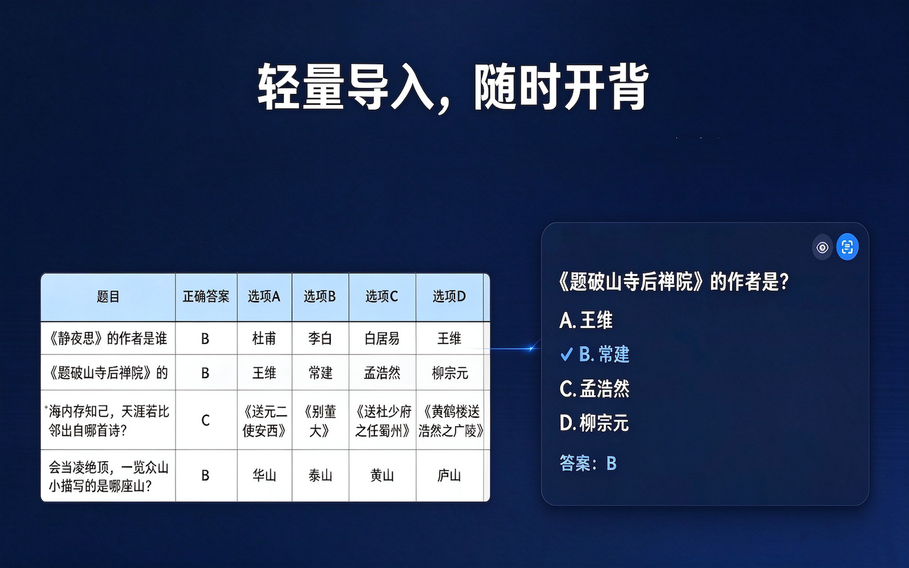
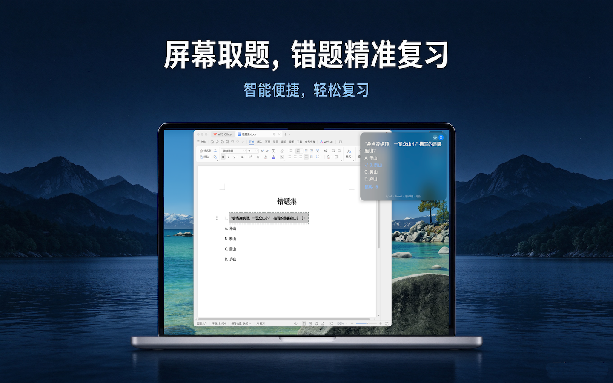

# 背题宝（QuizBar）

本产品灵感来自于本人的职级晋升考试，有题库完全没看~
QuizBar：把题库做成一张**置顶悬浮卡片**逐题循环播放。支持智能题型排版、选中取题（划选即查答案）、防拍模式、多工作表合并、背景明暗自适应。




## 目录结构

```
背题宝/
├── QuizBar-Mac/            macOS 版（Swift + Xcode 工程）
│   ├── QuizBar.xcodeproj
│   └── QuizBar/main.swift    全部功能代码（单文件）
├── QuizBar-windows/    Windows 版（Python）
│   ├── excelfloat.pyw        主程序（单文件）
│   └── 运行.bat               一键安装依赖并启动
└── readme.md
```

## 功能

- **悬浮轮播**：卡片置顶于所有应用之上，按设定间隔逐题循环，可暂停/上一条/下一条
- **智能排版**：自动识别单选（A~F）、多选（如 ABD）、判断（对/错/√/×）、简答题型，正确答案打 ✓ 高亮
- **选中取题**：在任意应用里划选题目文字，松开后本地 OCR 识别，卡片跳转到对应题目
- **防拍模式**：卡片在录屏、截图、共享屏幕中自动隐形，本机观看不受影响
- **多工作表合并**、**文件修改自动重载**、**背景明暗自适应**、**位置记忆**、**单实例保护**

## macOS 版

- 环境：Xcode（已配置开发团队签名）
- 构建：`xcodebuild -project QuizBar.xcodeproj -target QuizBar -configuration Release build`
- 产物：`build/Release/QuizBar.app`，拷贝到 `/Applications` 即可
- 全部功能代码集中在 `QuizBar/main.swift`，修改后重新构建并重启应用生效

## Windows 版

- 环境：Python 3.8+（Windows 10 2004+）
- 启动：双击 `运行.bat`（自动安装依赖 openpyxl / pillow / winsdk）
- 或直接把 `.xlsx` 拖到 `excelfloat.pyw` 图标上打开

## 题库模板


选择题

| 题目（必填）| 正确答案（必填）| 选项A（必填） |	选项B（必填）|	选项C	| 选项D |
|------|---------|-------|-------|-------|-------|
|《静夜思》的作者是谁 | B | 杜甫 | 	李白	| 白居易 |	王维 |
|《题破山寺后禅院》的作者是？|	B |	王维 |	常建	 |孟浩然 |	柳宗元 |

判断题

| 题目（必填）| 正确答案（必填）| 
|------|---------|
| “海内存知己，天涯若比邻” 出自《别董大》这首诗？| 	错误 |

简答题

| 题目（必填）| 答案 | 
|------|---------|
| 问题1 | 答案1 |


- 参见模版题库.xlsx

## 隐私

所有数据（题库、识别结果、设置）仅在本地存储和处理，不上传任何服务器。详见支持页中的《隐私政策》。
